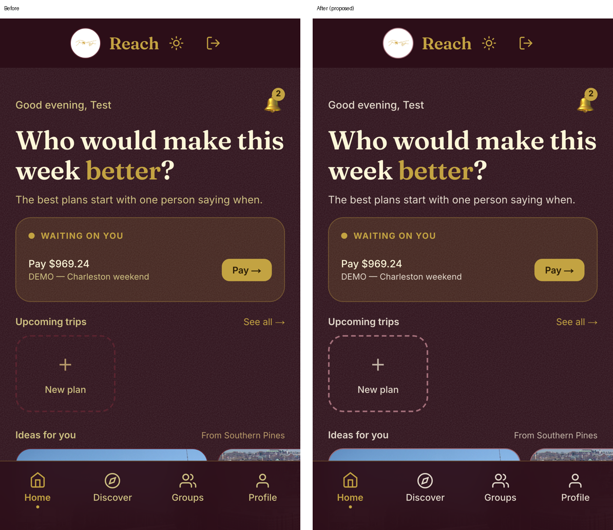
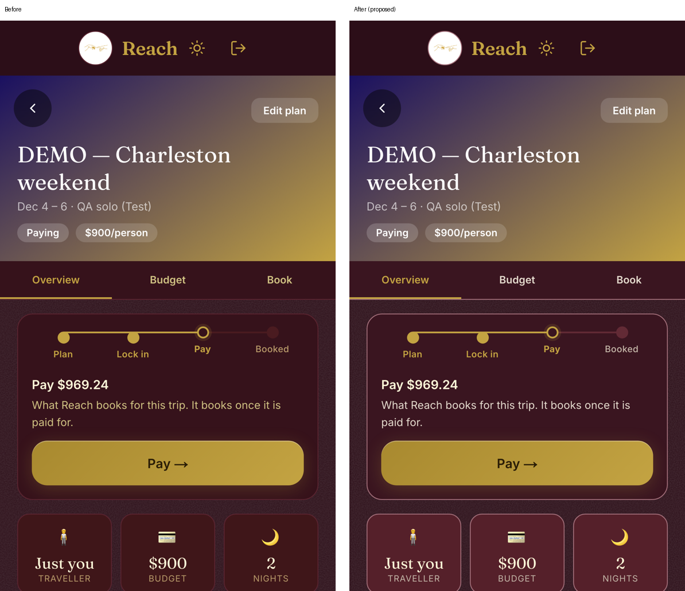
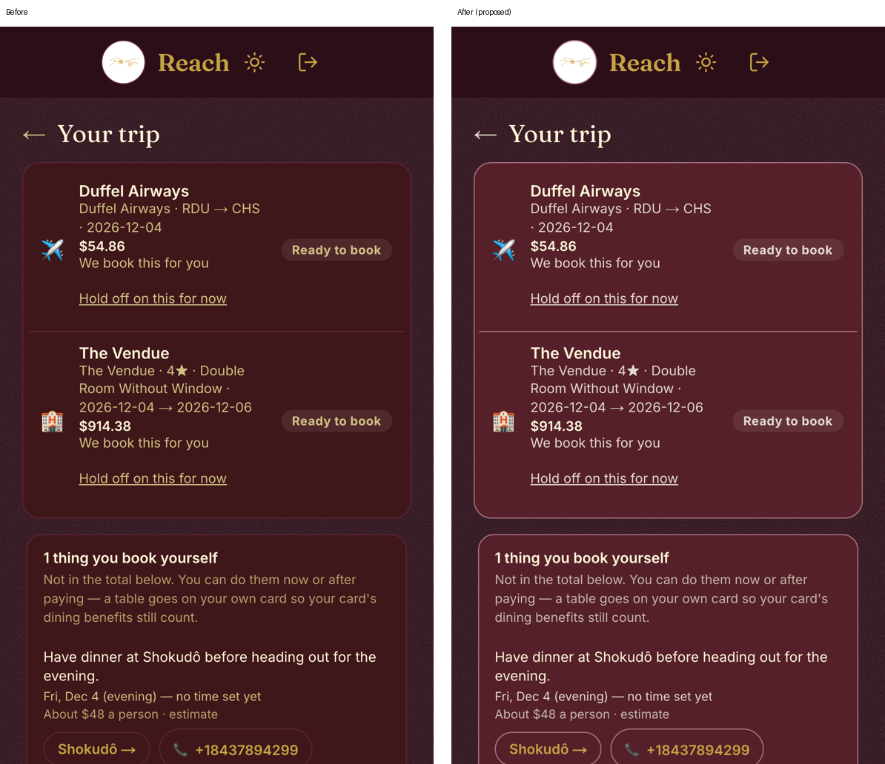
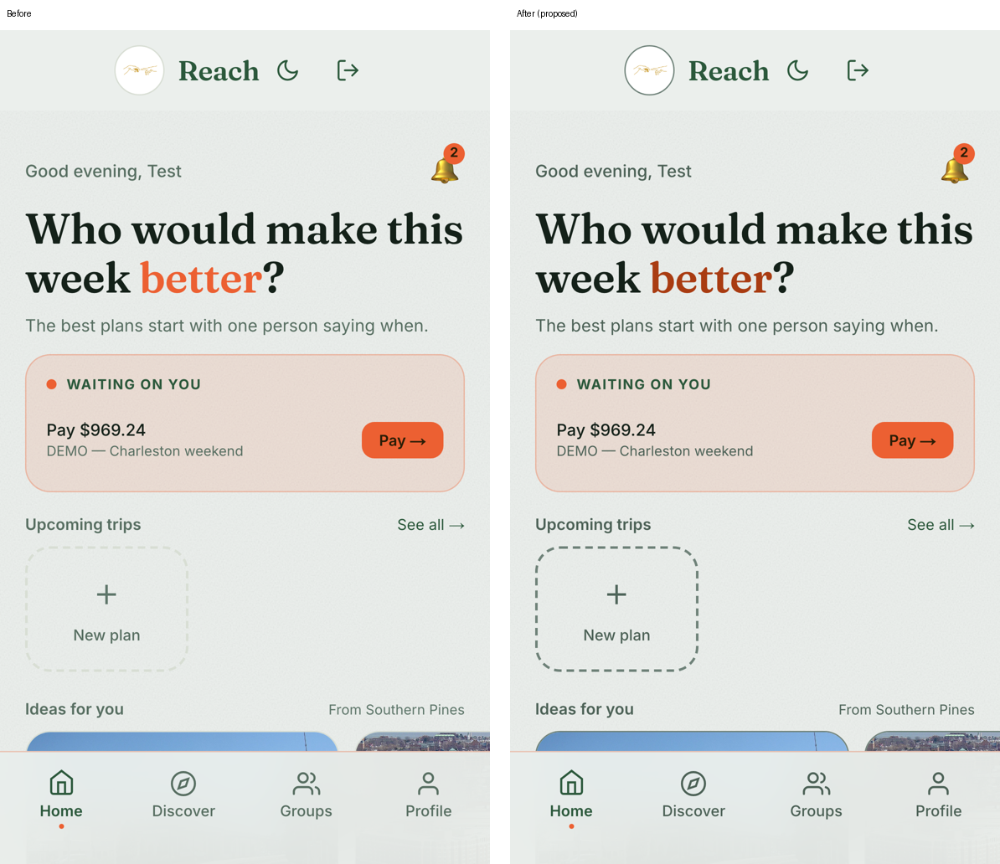
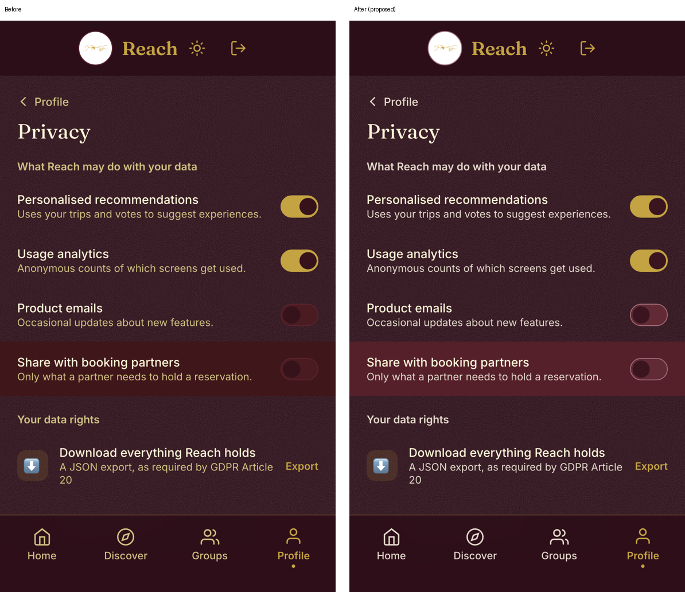

# Palette proposal: for approval

REACH-ACCESSIBILITY-PALETTE-2026-11-22, Task 1. Built from Task 0's real values (`STATUS.md`), not the
September ones. Maroon and gold stay, and light green with orange stays. Nothing here is applied until
you approve it.

**What changes, in one line each:**
- **Dark:** cards lift off the page, secondary text turns neutral so gold means "tappable", and control
  edges become visible.
- **Light:** cards turn white with a visible edge, the grey-green text darkens to pass, and the one
  orange word becomes rust.

## Tokens

Every ratio is WCAG contrast, measured. Targets: 4.5:1 text, 3:1 large text and control edges.

### Dark (maroon and gold, the default)

| Token | Used for | Now | Proposed | Result |
|---|---|---|---|---|
| `bg` | page | `#2C0E18` | unchanged | |
| `s1` | sheets, raised panels | `#36121B` | `#3A1520` | a small lift; `t1` on it 14.9:1 |
| `s2` | cards | `#3F1619` | **`#55202A`** | 1.37:1 on the page (was 1.13); `t1` on it 12.0:1 |
| `s3` | inputs and chips on a card | `#4A1B20` | `#622A35` | `t1` on it 10.3:1 |
| `border` | **edges of controls and cards** | `#5A2430` (1.46:1) | **`#A36F7A`** | 4.32:1 on the page, 3.14:1 on a card |
| `borderLight` | **dividers only** (hairlines in lists) | `#6B2C39` | unchanged | dividers are not controls, so they stay quiet |
| `t1` | headings, primary text | `#FEF7D9` | unchanged | 16.5:1 |
| `t2` | secondary text | `#CFC182` (tan) | **`#E3D9CC`** (neutral) | 12.7:1 page, 9.3:1 card, 7.9:1 `s3` |
| `t3`, `t4` | tertiary text | `#B89A6A`, `#9C815A` | **`#C4B6A8`** | 9.0:1 page, 6.5:1 card, 5.6:1 `s3` |
| `accent` / `accentText` | gold actions, links, logo | `#C3A342` | unchanged | 7.3:1 page, 5.3:1 card, 4.5:1 `s3`; dark label on it 6.8:1 |
| `red` | errors | `#E85D5D` | **`#FF9A8F`** | 8.7:1 page, 6.3:1 card; dark label on it 8.0:1 (the white "Delete" label, 3.4:1 today, becomes dark) |
| `green` | success | `#7FB58A` | `#86D6A6` | 10.3:1 page, 7.5:1 card |
| `amber` | warnings | `#E8A33D` | unchanged | 8.2:1 page, 6.0:1 card |
| `blue` | info | `#7FA8D9` | `#8FB5E3` | passes on `s3` too (was 4.47:1) |

### Light (off-white and green)

| Token | Used for | Now | Proposed | Result |
|---|---|---|---|---|
| `bg` | page | `#EBEFEC` | unchanged | |
| `s2` | cards | `#E4EAE6` (1.05:1) | **`#FFFFFF`** | separated by the edge below, not by a 7% shadow |
| `border` | edges of controls and cards | `#D8DED4` (1.18:1) | **`#6F8279`** | 3.52:1 page, 4.08:1 white card, 3.09:1 `s3` |
| `borderLight` | dividers only | `#C3CCC5` | unchanged | |
| `t1` | primary text | `#142119` | unchanged | 14.3:1 page, 16.7:1 card |
| `t2` | secondary text | `#576E61` (4.52:1 on a card) | **`#4C6156`** | 5.7:1 page, 6.7:1 card, 5.0:1 `s3` |
| `t3`, `t4` | tertiary text, 167 uses | `#5E766A` (**4.03:1 on a card**) | **`#4F655A`** | 5.4:1 page, 6.3:1 card, 4.8:1 `s3` |
| `accentText` | links, active tab, text in the brand colour | green `#2B583B` | unchanged | 7.1:1 page, 8.2:1 card |
| `accent` | orange fills (Pay, Get started) | `#EC6032` | **unchanged**, dark label | dark label on it 4.92:1 |
| new `accentWord` | the one orange word used as text (Home's greeting) | orange `#EC6032` (2.88:1) | **`#A93C12`** (rust) | 5.4:1; gold `#C3A342` in dark |
| `red` | errors | `#C0392B` (4.46:1 on a card) | **`#B3261E`** | 5.6:1 page, 6.5:1 card; white label on it 6.5:1 |
| `green` | success | `#2F7D43` (4.37:1) | **`#24693A`** | 5.7:1 page, 6.7:1 card |
| `amber` | warnings | `#6F4B00` | unchanged | 6.7:1 |
| `blue` | info | `#1E62C4` | `#1A56AD` | 6.1:1 page, 5.3:1 `s3` |

### Where this departs from your starting table, and why

1. **Light orange stays orange.** You proposed a rust (`#A93C12`) for the light accent with a white label.
   Light buttons already carry a dark label on the orange (4.92:1), which passes. So the bright orange,
   the brand's light-theme colour, can stay on every button. Rust is used only where orange is text: one
   place, Home's greeting.
2. **There is no light gold to fix.** The light app uses green for text and links, not gold. The only gold
   in light is the landing page's hands logo (2.31:1). It is a PNG with empty alt text, so it is decorative.
   I propose a darker recolour of the image (around `#7A5C10`, 4.9:1) in Task 5, not a token.
3. **The dark border is lighter than proposed** (`#A36F7A`, not `#8A5560`). `#8A5560` reaches 3.0:1 on
   the page but only 2.18:1 on the new card, where most controls sit.
4. **Borders split into two jobs.** `border` becomes the 3:1 edge for controls and cards, and `borderLight`
   stays for quiet dividers. Making every divider 3:1 would draw a heavy line under every list row.
5. **Tertiary text `t3` is fixed too.** Your table didn't list it, but it is the most-used failing colour
   in light (167 uses, 4.03:1 on a card).

## Before and after

The live app, with the proposed values swapped into its colour variables. No code changed. The left half
of each image is today; the right half is proposed.

| Screen | Image |
|---|---|
| Home, dark |  |
| Plan overview, dark: **in place of options** (no group holds ideas today; capturing options needs a QA trip generated, then called off) |  |
| Checkout, dark |  |
| Home, light |  |
| Privacy, dark: the "off" toggles, invisible today |  |

**What to look at:**
- Gold now stands out as "the thing to tap" (Pay, See all, the active tab, Export), because body text no
  longer shares its hue.
- The dashed "New plan" tile and the "off" toggles were near-invisible; now they read.
- Light "better" turns from orange to rust.

## Also in scope, outside the app's tokens

- **The landing page** has its own copy of the palette (`app/page.tsx`, `.lp{…}`). It moves to the same
  values, and its intro and "How it works" label pass on its page colour (today 4.31:1 and 3.35:1).
- **Sign-in and sign-up** (`lib/clerk-appearance.ts`, `components/ThemedAuth.tsx`) take the same values.
- **Email** (`lib/email.ts`, 30 colours) cannot read CSS variables. It gets a token map in `lib/brand.ts`
  and the raw-colour check treats that map as a token file.
- **The plan header's purple-to-orange gradient** carries white text that my audit cannot measure. I will
  check it by eye in Task 5 and darken the orange end if it fails.

## Decisions for you

1. **Approve the token table above**, or name any value to change.
2. **Approve splitting borders** into edge (3:1) and divider (quiet).
3. **May I add `@axe-core/playwright`** as a dev-only dependency for Task 6's automated sweep? It never
   ships to the app.
4. **May I generate one QA trip and call it off** in Task 5, so options and voting get screenshots? It goes
   in the QA test group only and is called off straight after.
